# Create: Skyliners

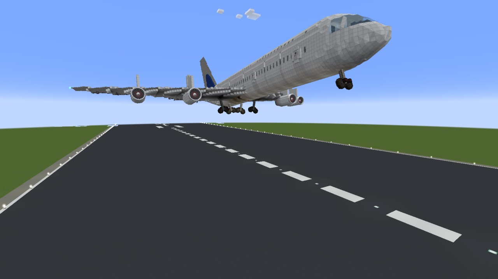

Giant aircraft for [Create](https://modrinth.com/mod/create) and
[Create Aeronautics](https://modrinth.com/mod/create-aeronautics), each laid down whole by a single blueprint: an
A380-style airliner, a Hindenburg-sized zeppelin and a retro rocket. They are big enough to walk around in, furnished
inside, and they really fly, on their own autopilots, with you and your friends aboard.

## What's inside

- **The airliner**: 145 blocks long, two decks, a flight deck, working doors, airstairs and evacuation slides.
  Furnished, it adds business class, a moon pool with a glass floor and a springboard, a gym hall with basketball hoops,
  a lounge bar under a starlit ceiling, duty free, a secret den and a hold full of luggage. Its autopilot takes off,
  flies to a pin you drop on its map and lands on a runway, with callouts, air traffic control on the radio and cabin
  announcements.
- **The zeppelin**: 490 blocks of airship (245 at half size) floating on hot air in sixteen coloured gas cells, with a
  control car under the bow, passenger decks behind promenade windows, a techno club, a sky crane and liveries to
  repaint her in. A festive edition comes dressed for Christmas.
- **The rocket**: as tall as the airliner is long, standing on four fins, with storeys round a glass lift, a lab, a
  greenhouse, an observation deck, a rover and a cockpit in the nose. She lifts off from her pad, climbs to the edge of
  space, where everyone aboard floats, and lands back where she rose.
- **The airfield**: a runway sized for the airliner, a control tower, a launch pad and a jet bridge.
- **Things to do aboard**: skydive, take villagers along with boarding passes, push the meal trolley down the aisle,
  fold paper planes, hunt for rubber ducks and earn the First Flight advancements.

Every control is a picture, a colour or a sound, so players who cannot read yet can fly too.

## Screenshots

<table>
  <tr>
    <td>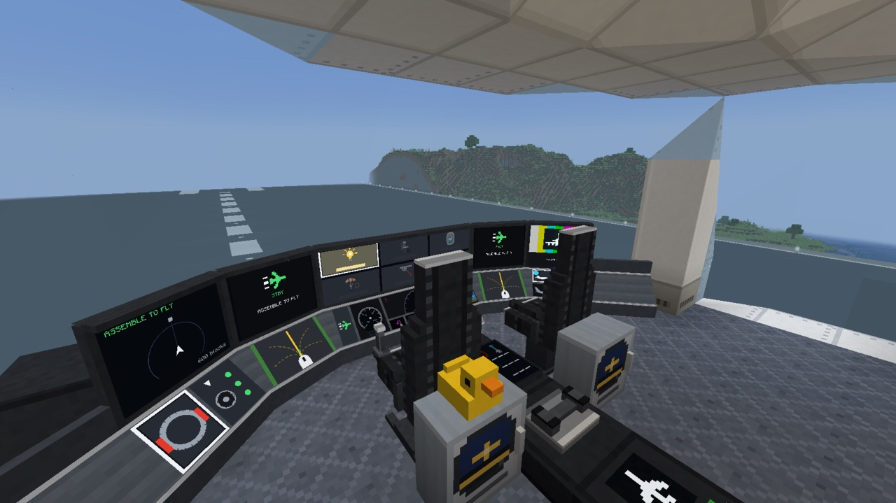 The flight deck</td>
    <td>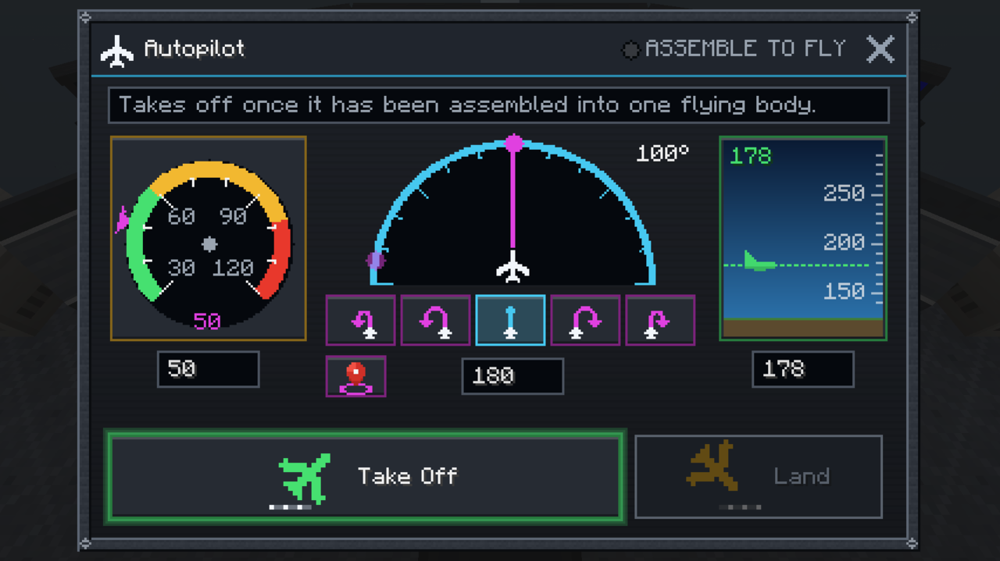 The autopilot</td>
    <td>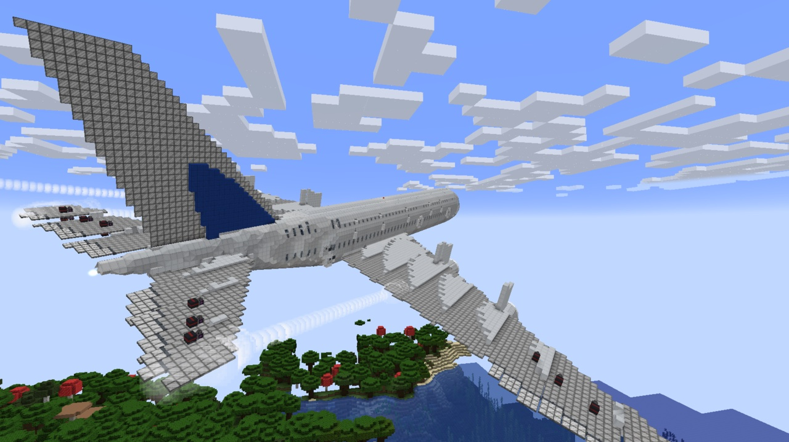 In flight</td>
  </tr>
  <tr>
    <td>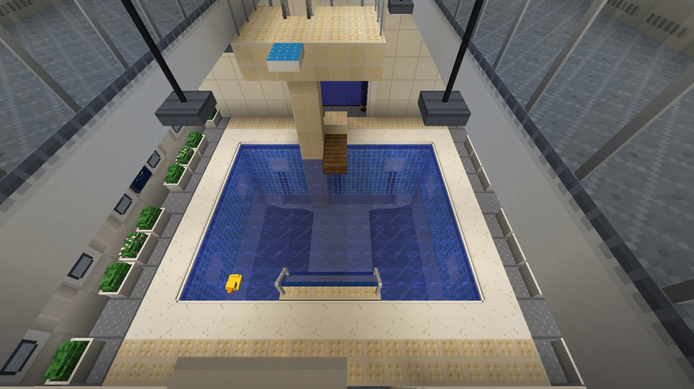 The moon pool</td>
    <td>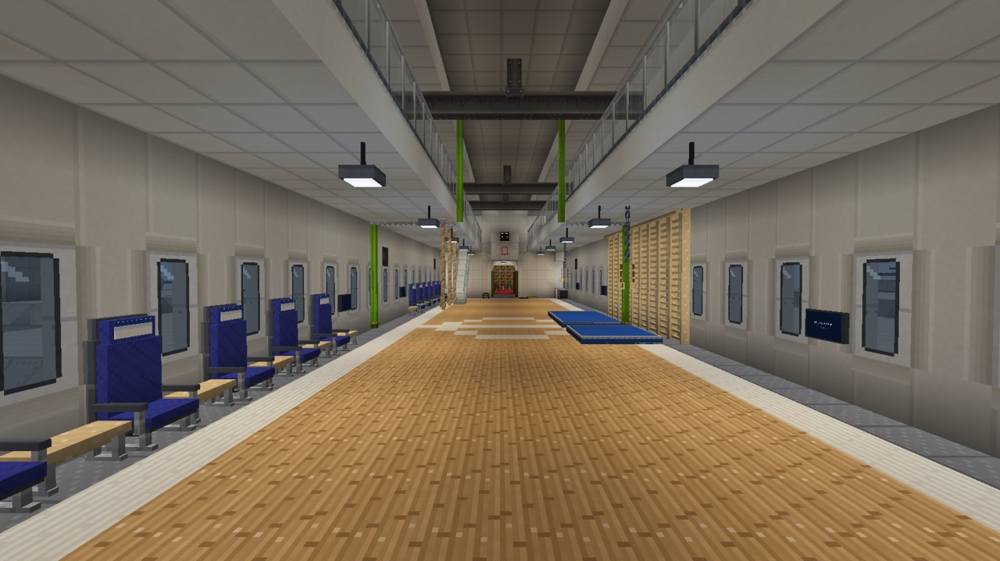 The gym hall</td>
    <td>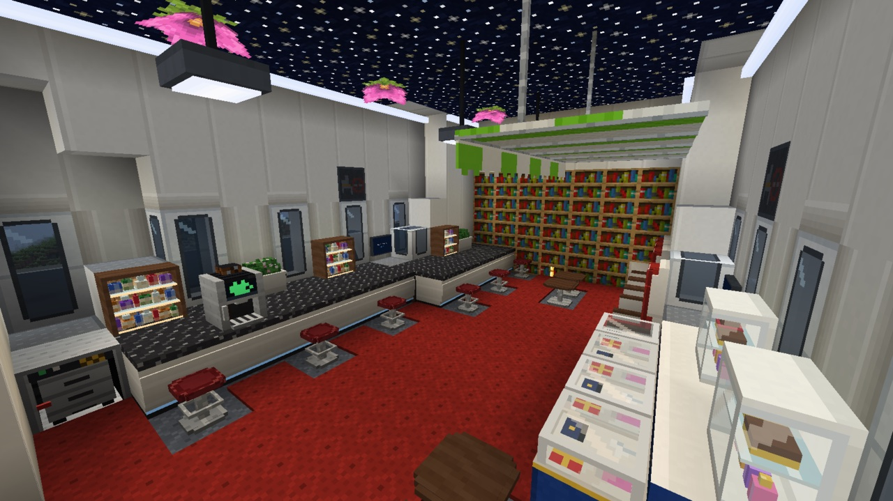 The lounge bar</td>
  </tr>
  <tr>
    <td>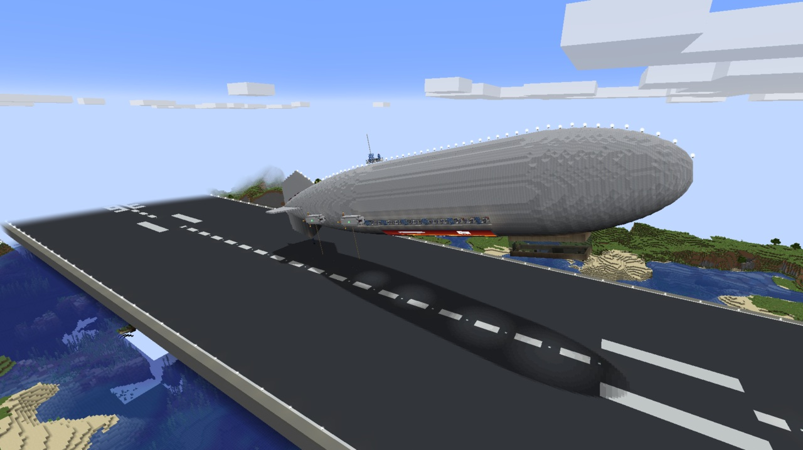 The zeppelin lifting off</td>
    <td>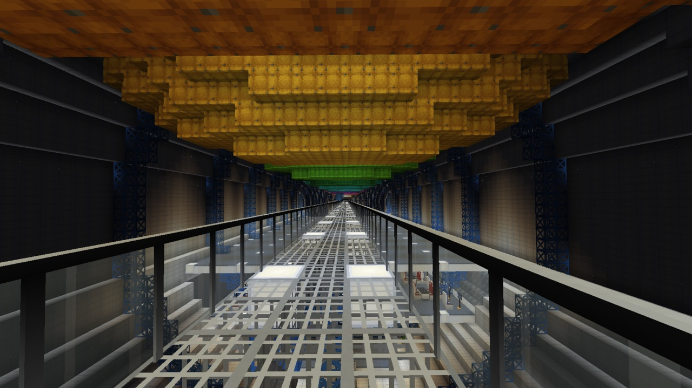 Inside her hull</td>
    <td>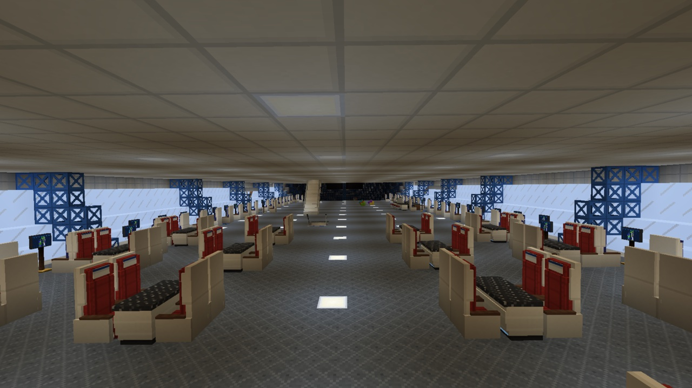 Her passenger deck</td>
  </tr>
  <tr>
    <td>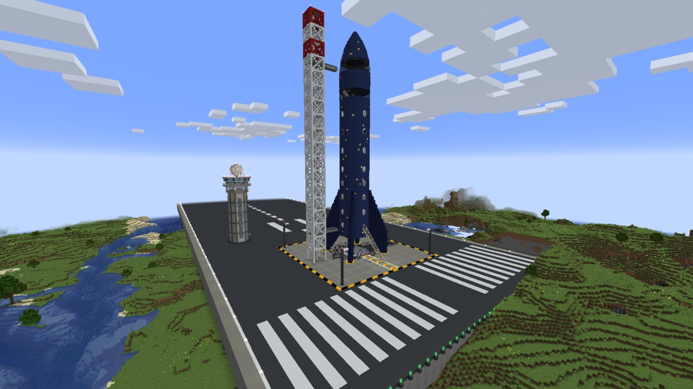 The rocket on her pad</td>
    <td>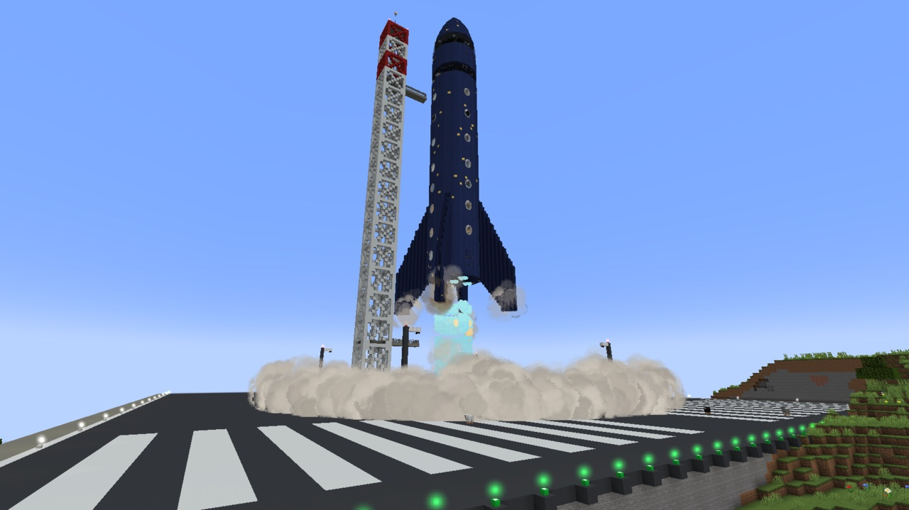 Lift-off</td>
    <td>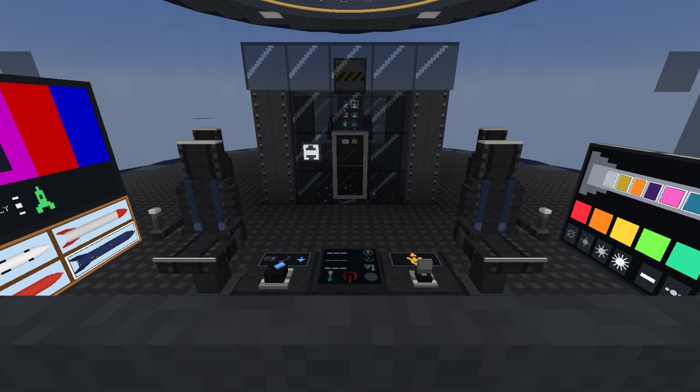 Her cockpit</td>
  </tr>
</table>

More in [docs/images](docs/images).

## Videos

With sound, recorded in game: [the airliner taking off](docs/videos/airliner-take-off.mp4),
[the rocket's launch](docs/videos/rocket-launch.mp4) and [the zeppelin in flight](docs/videos/zeppelin-flight.mp4).

<video src="docs/videos/rocket-launch.mp4" controls muted width="100%"></video>

## Getting started

You need Minecraft 1.21.1 with [NeoForge](https://neoforged.net) 21.1.251 or newer, and:

- [Create](https://modrinth.com/mod/create) 6.0.10 or newer
- [Create Propulsion: Simulated](https://modrinth.com/mod/create-propulsion-simulated)
- [Create Aeronautics](https://modrinth.com/mod/create-aeronautics) and [Sable](https://modrinth.com/mod/sable), to
  fly; without them the aircraft are buildings

Then:

1. In creative mode, open the **Create: Skyliners** tab. The blueprints come first; they have no recipe.
2. Hold a blueprint and aim at open ground: a see-through preview shows where it will stand. Use it to build, sneaking
   to build through whatever is in the way. The Runway Blueprint lays down a runway to take off from.
3. Climb the airstairs to the flight deck and fold them away with the lit button by the door.
4. Open the autopilot, set a speed, a heading and a height, or drop a pin on its map, and press Take Off. It assembles
   the airliner into one flying body and goes. The zeppelin's autopilot is in her control car under the bow, the
   rocket's in her cockpit at the top.

Operators can also run `/skyliners build <pos> <north|east|south|west> [furnished|zeppelin|rocket|launch_pad]`. The
settings are under Mods → Create: Skyliners → Config.

## Learn more

- [The guide](docs/guide.md): everything in the mod, as a player meets it.
- [Building](docs/building.md): how the mod is built and which classes do what. `./gradlew build` writes the jar to
  `build/libs/`.
- [AGENTS.md](AGENTS.md): the rules the code keeps, for contributors.
- [Backlog](docs/backlog.md): what is still open.

## License

Dual licensed under [Apache-2.0](LICENSE-APACHE) or [MIT](LICENSE-MIT), at your option; see also [NOTICE](NOTICE).
Unless you say otherwise, a contribution you submit for inclusion is dual licensed the same way, with no further terms.

Not an official Minecraft product. Not approved by or associated with Mojang or Microsoft.
